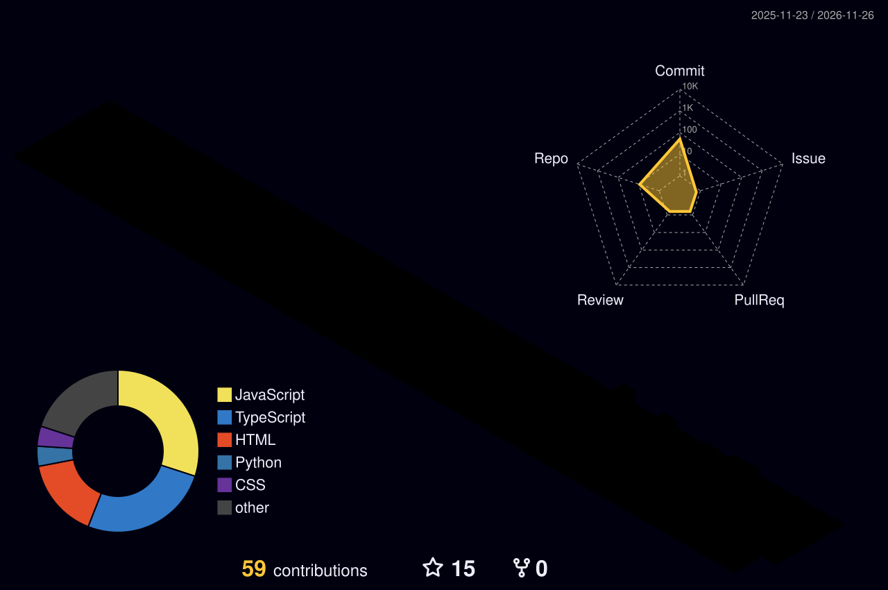

<!-- 3D Neon Wave Header -->
<div align="center">
  
</div>

<!-- Optional: Uncomment after uploading your exported Spline 3D animation to assets/spline-hero.gif -->
<!--
<div align="center">
  
</div>
-->

<!-- Dynamic Terminal Typing Banner -->
<div align="center">
  <a href="https://git.io/typing-svg">
    
  </a>
</div>

<!-- Social Links, Connect & Live Views -->
<div align="center">
  <a href="https://www.linkedin.com/in/ayanangshu-goswami-5a5656298/"></a>
  <a href="mailto:ayanangshugoswamiabir@gmail.com"></a>
  <a href="https://www.instagram.com/abiirrr___/"></a>
  
  
</div>

<br/>

<div align="center">
  
</div>

<br/>

## 👨‍💻 System Profile

```typescript
const ayanangshu: EngineerProfile = {
  name: "Ayanangshu Goswami",
  role: "Full-Stack Developer & AI/ML Engineer",
  location: "Kolkata / Bhubaneswar, India",
  education: "B.Tech in Information Technology @ KIIT (2023 - 2027)",
  experience: "Full-Stack Development Intern @ VeritasCo. (A+ Rated)",
  coreDomains: ["Full-Stack Web Architecture", "Generative AI & LLMs", "REST & Real-Time APIs", "Cloud Deployment"],
  aiStack: ["LangGraph", "OpenAI API", "Gemini API", "Groq API", "PyTorch", "Scikit-learn","Matplotlib","Langchain","RAG","Pandas","Numpy","Tensorflow"],
  currentlyGrinding: ["Data Structures & Algorithms (Java)", "Distributed System Design", "Agentic Workflows"],
  availability: "Open to Software Engineering, Full-Stack & AI/ML Roles (2027 Grad)",
  Portfolio: "https://ayanangshugoswamiportfolio.vercel.app/"
};
```

<br/>

<div align="center">
  
</div>

<br/>

## 🏙️ 3D Isometric Contribution Skyline

<div align="center">
  <picture>
    <source media="(prefers-color-scheme: dark)" srcset="./profile-3d-contrib/profile-night-rainbow.svg" />
    <source media="(prefers-color-scheme: light)" srcset="./profile-3d-contrib/profile-season-animate.svg" />
    
  </picture>
</div>

<br/>

<div align="center">
  
</div>

<br/>

## 💼 Experience & Credentials

<table>
  <tr>
    <td width="50%" valign="top">
      <h3>🏢 Industry Experience</h3>
      <b>Full-Stack Development Intern — VeritasCo.</b><br/>
      <sub><i>July 2026 – August 2026 • Overall Evaluation: A+</i></sub>
      <ul>
        <li>Engineered core full-stack modules with <b>Next.js, TypeScript, Tailwind CSS, Node.js, Express.js, PostgreSQL &amp; Prisma ORM</b>.</li>
        <li>Integrated <b>JWT authentication</b>, <b>OpenAI API pipelines</b>, and <b>Cloudinary</b> asset workflows.</li>
        <li>Managed containerized deployments using <b>Docker</b> and CI/CD pipelines on <b>Vercel &amp; Render</b>.</li>
      </ul>
    </td>
    <td width="50%" valign="top">
      <h3>🎓 Education &amp; Certifications</h3>
      <b>B.Tech in Information Technology — KIIT University</b><br/>
      <sub><i>2023 – 2027 • Bhubaneswar, Odisha</i></sub>
      <br/><br/>
      <b>🏅 Certifications &amp; Simulations</b>
      <ul>
        <li><b>AWS Cloud Foundations</b> — Amazon Web Services (2025)</li>
        <li><b>Deloitte Australia Technology Job Simulation</b> — Forage (2025)</li>
      </ul>
    </td>
  </tr>
</table>

<br/>

<div align="center">
  
</div>

<br/>

## 🚀 Featured Engineering Projects

<table>
  <thead>
    <tr>
      <th width="24%">Project</th>
      <th width="46%">Architecture &amp; Impact</th>
      <th width="30%">Tech Stack</th>
    </tr>
  </thead>
  <tbody>
    <tr>
      <td><b>🤖 CareerCraft AI</b><br/><sub>AI Career &amp; ATS Platform</sub></td>
      <td>
        End-to-end AI career suite featuring automated resume parsing, ATS compatibility scoring, job-description matching, and interactive AI interview preparation using dual LLM inference.
      </td>
      <td>
        <code>React</code> <code>TypeScript</code> <code>Vite</code> <code>Node.js</code> <code>Express</code> <code>MongoDB</code> <code>JWT</code> <code>Multer</code> <code>Gemini API</code> <code>Groq AI</code>
      </td>
    </tr>
    <tr>
      <td><b>🏍️ Bike Resale Price Predictor</b><br/><sub>ML Valuation Engine</sub></td>
      <td>
        Supervised regression pipeline trained on 7 vehicle parameters tailored for the Indian market, achieving an <b>R² score of 0.9956</b> with an interactive FastAPI depreciation visualization dashboard.
      </td>
      <td>
        <code>Python</code> <code>Scikit-learn</code> <code>Pandas</code> <code>FastAPI</code> <code>Matplotlib</code> <code>JavaScript</code> <code>HTML/CSS</code>
      </td>
    </tr>
    <tr>
      <td><b>📚 Library Management System</b><br/><sub>Enterprise MERN Platform</sub></td>
      <td>
        Full-stack RBAC platform supporting <b>Admin, Librarian &amp; Student</b> tiers with QR-code book lookups, automated email alerts via <code>node-cron</code>, Cloudinary uploads, Swagger API docs, and analytics.
      </td>
      <td>
        <code>React</code> <code>Tailwind CSS</code> <code>Node.js</code> <code>Express</code> <code>MongoDB</code> <code>JWT</code> <code>Cloudinary</code> <code>Swagger</code>
      </td>
    </tr>
  </tbody>
</table>

<br/>

<div align="center">
  
</div>

<br/>

## 🛠️ Tech Stack & Architecture Matrix

<div align="center">

#### ⚡ Languages & Frontend


<br/><br/>

#### ⚙️ Backend, Databases & Cloud Infrastructure


<br/><br/>

#### 🧠 AI / ML, LLMs & Developer Ecosystem


<br/><br/>


</div>

<br/>

<div align="center">
  
</div>

<br/>

## 🐍 Interactive Contribution Snake

<div align="center">
  <picture>
    <source media="(prefers-color-scheme: dark)" srcset="https://raw.githubusercontent.com/AyanangshuGoswami/AyanangshuGoswami/output/github-contribution-grid-snake-dark.svg" />
    <source media="(prefers-color-scheme: light)" srcset="https://raw.githubusercontent.com/AyanangshuGoswami/AyanangshuGoswami/output/github-contribution-grid-snake.svg" />
    
  </picture>
</div>

<br/>

<div align="center">
  
</div>

<br/>

## 🏆 GitHub Trophies & Telemetry Dashboard

<div align="center">
  
</div>

<br/>

<div align="center">
  
  
</div>

<br/>

<div align="center">
  
</div>

<br/>

<div align="center">
  
</div>

<br/>

<div align="center">
  
</div>

<br/>

## 🔍 Deep Dive (Interactive Panels)

<details>
  <summary><b>⚡ What I'm Building &amp; Learning Right Now</b></summary>
  <br/>
  <ul>
    <li><b>Agentic AI Systems:</b> Multi-step orchestration with LangGraph, tool-calling pipelines, and structured LLM outputs.</li>
    <li><b>Backend Scalability:</b> PostgreSQL indexing, Redis caching strategies, WebSockets, and Dockerized microservices.</li>
    <li><b>Interview Readiness:</b> Daily DSA problem solving in Java and clean system architecture patterns.</li>
  </ul>
</details>

<details>
  <summary><b>🖥️ Dev Environment &amp; Workflow</b></summary>
  <br/>
  <ul>
    <li><b>IDE &amp; Runtime:</b> VS Code, Vite, Node.js, Python 3.x, Docker Desktop</li>
    <li><b>API &amp; DB Tooling:</b> Postman, Swagger/OpenAPI, Prisma Studio, MongoDB Compass</li>
    <li><b>Deployment Stack:</b> AWS (EC2, S3, VPC), Vercel, Render, Cloudflare, GitHub Actions</li>
  </ul>
</details>

<br/>

## ✍️ Random Dev Quote

<div align="center">
  
</div>

<br/>

<!-- 3D Neon Wave Footer -->
<div align="center">
  
</div>
